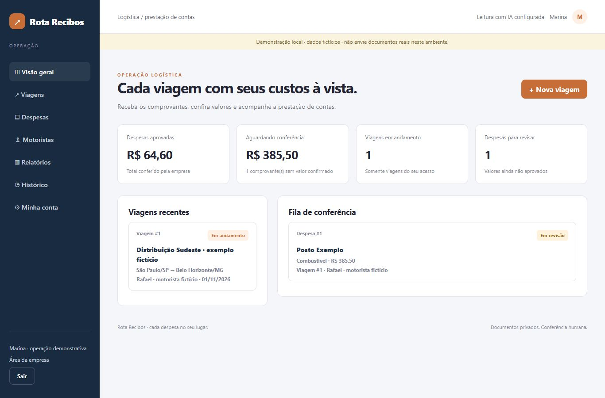

# Rota Recibos

Do comprovante do motorista à prestação de contas conferida pela empresa.

   



## Por que existe

Comprovantes dispersos dificultam acompanhar os custos de uma viagem. O Rota Recibos conecta motorista e operação em um fluxo de envio, leitura assistida, revisão e consolidação de despesas.

## Funcionalidades

- Acessos separados: motorista vê suas viagens; empresa acompanha a operação.
- Comprovantes de combustível, pedágio, alimentação, hospedagem e outros.
- Leitura de PDF, foto e texto com Gemini, seguida de conferência humana.
- Envio, aprovação e devolução com justificativa e controle de versão.
- Alerta de duplicidade, custos por categoria e UF e valores em centavos.
- CSV de aprovadas por viagem, relatórios, anexos privados e backup.

## Como funciona

**Empresa cria viagem → motorista anexa e confere → empresa revisa → custos aprovados e CSV.**

A IA propõe os campos do documento. As pessoas conferem os dados; as regras do servidor validam permissões, estados e valores. Nenhuma despesa ou proposta é aprovada automaticamente.

## Tecnologias

Node.js 24, HTTP nativo, SQLite, JavaScript no navegador e API Gemini. Aplicação cliente-servidor responsiva, sem dependências npm de runtime.

## Executar

Requisito: **Node.js 24 LTS**.

```sh
git clone https://github.com/BernardoReges/rota-recibos.git
cd rota-recibos
npm run demo
```

Abra o endereço informado no terminal. A demonstração usa dados fictícios. Para habilitar a leitura por IA, configure **sua própria chave** no servidor conforme o [guia de instalação](docs/INSTALACAO.md). O fluxo manual funciona sem chave.

## Validação

```sh
npm test
```

**32 testes aprovados** na versão 0.1.1, cobrindo regras de negócio, permissões, sessões, arquivos e isolamento dos dados demonstrativos. Os ensaios com IA usam documentos sintéticos. Consulte os [resultados, imagens e limites](docs/VALIDACAO.md); ainda não houve piloto com usuários reais.

## Documentação

| Guia                               | Conteúdo                                 |
| ---------------------------------- | ---------------------------------------- |
| [Instalação](docs/INSTALACAO.md)   | Configuração, IA, Docker, dados e backup |
| [Arquitetura](docs/ARQUITETURA.md) | Componentes e decisões técnicas          |
| [API](docs/API.md)                 | Rotas, contratos e permissões            |
| [Escopo](docs/ESCOPO.md)           | Critérios e evolução planejada           |
| [Segurança](SECURITY.md)           | Credenciais, privacidade e operação      |
| [Contribuição](CONTRIBUTING.md)    | Como colaborar                           |

## Licença e autoria

[MIT](LICENSE) · [BernardoReges](https://github.com/BernardoReges). Desenvolvimento assistido por IA. A infraestrutura inicial de autenticação, persistência e extração é compartilhada com CotaFlux; os fluxos e testes de negócio são próprios de cada projeto.

Somente exemplos fictícios acompanham o código. Chaves de API, bancos, backups e documentos privados ficam fora do repositório.
