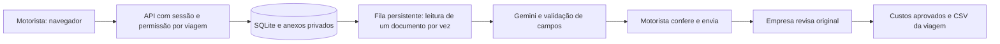

# Rota Recibos

**Prestação de contas de viagens: do comprovante do motorista à planilha conferida da empresa.** Aplicação web cliente-servidor, com acessos separados, anexos privados, leitura assistida por IA e aprovação humana.


[Área móvel do motorista](docs/mobile.png) · [Conferência do comprovante](docs/comprovante.png) · [Relatórios](docs/relatorios.png)

## O problema

Uma empresa que gerencia motoristas recebe fotos e PDFs de abastecimentos, pedágios, refeições e hospedagens. Sem vínculo com a viagem, os comprovantes acabam dispersos, valores são digitados novamente e a operação perde a distinção entre despesa recebida e despesa aprovada.

O Rota Recibos organiza esse fluxo. O motorista não precisa montar uma planilha: envia o comprovante na viagem certa, confere os dados e encaminha para a empresa. A operação revisa o original, devolve inconsistências ou aprova a despesa.

## Fluxo implementado

1. A empresa cadastra o motorista e cria uma viagem com origem, destino, período, orçamento e adiantamento de referência.
2. O motorista entra em seu acesso e vê somente as viagens vinculadas a ele.
3. Anexa um comprovante PDF, foto JPG/PNG ou TXT, com limite de 8 MB.
4. Autoriza a leitura do documento pelo Gemini ou preenche os campos manualmente.
5. Confere estabelecimento, data, categoria, total pago, cidade, UF e número do recibo, quando houver.
6. Envia a despesa. O motorista não pode aprovar nem alterar uma despesa já enviada.
7. A empresa compara com o original e aprova ou devolve, com justificativa. Uma devolução pode ser corrigida e reenviada.
8. Cada revisão atualiza o CSV de despesas aprovadas da viagem. O painel também gera o download atualizado.

### Categorias

Combustível, pedágio, alimentação, hospedagem e outros. Há suporte a cidades e UFs brasileiras e somente valores em BRL. O sistema não estima pedágios, calcula rotas nem integra GPS.

## Controle dos valores

- Dinheiro é guardado em centavos inteiros; a IA não executa a soma dos custos.
- Aprovado, pendente e devolvido aparecem separados.
- Orçamento e adiantamento são referências registradas, sem pagamento ou movimentação bancária.
- Datas precisam estar no período da viagem. Moeda estrangeira e UF inválida são rejeitadas.
- O mesmo arquivo é bloqueado por hash. Repetição de estabelecimento, data e valor na mesma viagem gera uma possível duplicidade que exige confirmação; isso não comprova fraude.
- Não é possível encerrar uma viagem com despesas pendentes ou devolvidas.
- Relatórios da empresa filtram por período, categoria e UF, com totais por categoria/estado e CSV consolidado de aprovadas.
- Fotos e textos podem ser conferidos no próprio painel, usando o mesmo controle de acesso dos downloads.
- O total pendente sinaliza quando há comprovantes ainda sem valor confirmado.
- Uma resposta atrasada da IA não substitui campos que a pessoa já editou.

## Planilha vinculada à viagem

Após a revisão da empresa, o servidor atualiza `DATA_DIR/exports/viagem-N-aprovadas.csv`, usando o banco como fonte. A planilha é reconstruída, evitando acrescentar a mesma linha a cada aprovação. O download autorizado em **Exportar aprovadas em planilha CSV** também lê o estado atual do banco.

Colunas: viagem, motorista, data, categoria, estabelecimento, cidade, UF, valor em reais, recibo e situação, com total aprovado ao final. O formato usa UTF-8 com BOM, separador `;` e decimal `,`, adequado à importação no Excel e no LibreOffice configurados para português brasileiro. Textos com prefixos de fórmulas são escapados.

O CSV é uma planilha interoperável, não um arquivo XLSX com gráficos. **Não há sincronização permanente com Google Sheets ou Microsoft 365 nesta versão.** Se houver falha ao gravar o CSV local, ela é registrada no histórico; o banco mantém a decisão e o download continua sendo gerado a partir dele. Inclua a pasta de dados na rotina de backup.

## Experimente em minutos

Requisito: **Node.js 24 LTS**. Sem dependências npm de runtime.

```sh
npm run demo
```

Abra **http://127.0.0.1:3070**. Na demonstração, escolha **Entrar como motorista** ou **Entrar como empresa**. Os acessos reais são verificados no servidor; não é apenas uma troca visual de perfil.

Sugestão de teste:

1. Entre como motorista e abra a viagem fictícia.
2. Selecione o comprovante de pedágio em rascunho ou anexe um arquivo de `fixtures/`.
3. Autorize a leitura, confira os campos e envie à empresa.
4. Saia e entre como empresa. Abra a fila de despesas, confira o original e registre uma decisão.
5. Abra a viagem e exporte a planilha. Somente aprovadas entram no total.

Não envie dados reais ao ambiente de demonstração. O botão de acesso sem senha só existe quando `DEMO=true`, e essa modalidade só inicia em loopback.

## Instalação real separada

Copie `.env.example` para `.env` e configure a sua chave e uma pasta diferente da demonstração:

```dotenv
GEMINI_API_KEY=sua_chave_somente_no_arquivo_local
GEMINI_MODEL=gemini-3.1-flash-lite
GEMINI_VISION_MODEL=gemini-3.5-flash-lite
DATA_DIR=D:/DadosProjetos/rota-recibos-real
DEMO=false
```

```sh
npm start
```

Na primeira abertura, crie o acesso da empresa com senha de pelo menos 12 caracteres. O administrador cria os acessos dos motoristas e entrega as senhas por canal privado. Não existe senha padrão de produção. A troca de senha própria está disponível em Minha conta e encerra outras sessões. Recuperação de senha e MFA ainda precisam ser implementadas antes de exposição pública.

O adaptador aceita `LLM_API_KEY` como compatibilidade com configuração privada existente. A chave do autor não acompanha o código. Sem IA configurada, o cadastro, envio, preenchimento manual, revisão e exportação continuam disponíveis.

### Cliente-servidor e uso pelo celular

O navegador é o cliente; os dados e os documentos ficam no servidor da empresa. O layout é responsivo e usa o seletor de arquivos do navegador. A captura por câmera depende do sistema e do navegador do aparelho; não foi homologada em um celular físico.

O endereço `127.0.0.1` funciona apenas no próprio computador. Para vários aparelhos, é necessário hospedar o servidor em endereço alcançável, com proxy HTTPS, `APP_ORIGIN` exato, `SECURE_COOKIES=true` e demonstração desligada. Nenhuma hospedagem, túnel público ou regra de firewall foi criada nesta entrega.

`docker compose up --build` inclui uma receita de instalação vazia em **http://localhost:3070**, com volume persistente e porta restrita ao loopback. A receita está preparada, mas a execução Docker não foi homologada nesta entrega; os testes foram feitos com Node no Windows.

## Dados, acessos e privacidade

Uma instalação representa uma empresa de gestão logística. O administrador vê todas as viagens dessa instalação; cada motorista vê somente as suas. Empresas diferentes devem usar instalações e bancos separados. Não há portal SaaS multiempresa.

O SQLite em `DATA_DIR/app.sqlite` guarda usuários, sessões, viagens, despesas, anexos, fila e eventos. Os anexos são BLOBs privados: não há pasta pública de comprovantes. Downloads verificam a sessão e a permissão. Limites atuais: 8 MB por arquivo e 500 documentos por instalação.

A IA recebe o documento completo autorizado. Não há anonimização garantida de foto ou PDF, e o filtro de saída não impede que dados sensíveis do original sejam transmitidos. Use somente o necessário e avalie as condições do provedor antes de dados reais. A extração instrui o modelo a não reproduzir CPF, dados bancários ou cartões. Isso é uma redução de exposição na saída, não uma garantia de remoção na entrada.

Senhas usam scrypt e salt; sessões usam tokens aleatórios com hashes no banco e vencimento. O SQLite, os CSVs e backups não são criptografados pelo aplicativo. Proteja a máquina e o volume. Veja [SECURITY.md](SECURITY.md).

## Backup e restauração

```sh
npm run backup -- D:/Backups/RotaRecibos
```

O backup usa a API online do SQLite e valida integridade. Inclui os anexos, mas não a chave do provedor; guarde o `.env` de forma privada separada. Para restaurar, pare o servidor, preserve a pasta original, copie o backup para uma pasta nova como `app.sqlite` e aponte `DATA_DIR` para ela. As exportações podem ser regeneradas dos registros aprovados. Não substitua bancos em execução nem publique bancos, CSVs reais ou backups.

## Arquitetura e testes



```sh
npm test
npm run evaluate:ai
```

Os testes cobrem permissões entre motoristas, transições, duplicidade, totais, arquivos, sessões, falhas e respostas atrasadas. Os ensaios reais da IA incluem texto, imagem e PDF fictícios, com total pago, troco e campos desconhecidos. Isso não mede acurácia em fotos reais de estrada, documentos fiscais variados ou imagens de baixa qualidade.

Leia [a validação e seus limites](docs/VALIDACAO.md), [a arquitetura](docs/ARQUITETURA.md), [o contrato da API](docs/API.md) e [o escopo](docs/ESCOPO.md).

## Código aberto e publicação

A recomendação é **código aberto sob MIT**, com infraestrutura reproduzível e comprovantes sintéticos. Os documentos, cadastros e credenciais de cada instalação são privados e não acompanham o código. Open source permite cópia e adaptação conforme a licença.

Desenvolvido com assistência de IA, usando padrões conhecidos de software. O responsável pelo portfólio deve compreender e explicar suas contribuições, sem reivindicar exclusividade da ideia ou certificação. Não há vínculo ou aprovação do iFood.

O projeto permanece local para revisão do proprietário: nenhum repositório remoto, envio ao GitHub, domínio público ou implantação foi criado.
