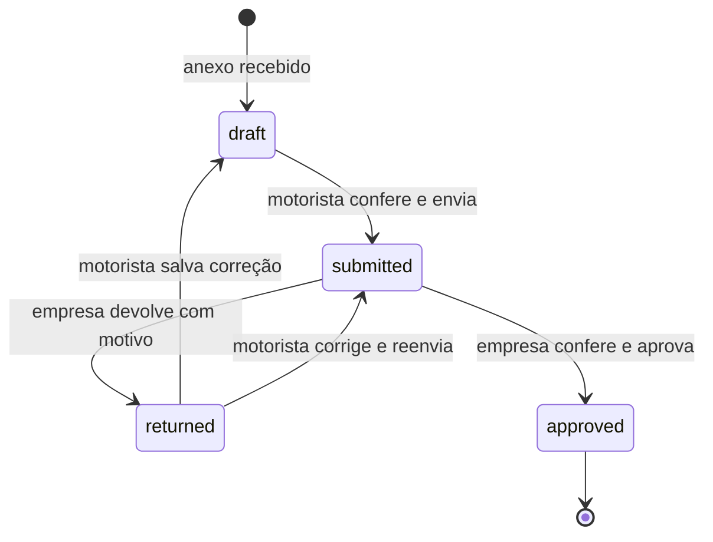

# Arquitetura e decisões

O cliente é um navegador responsivo. O servidor aplica as permissões e mantém os dados. Fechar o navegador do motorista não apaga seus comprovantes.

| Componente                    | Responsabilidade                                           |
| ----------------------------- | ---------------------------------------------------------- |
| `public/app.mjs`              | Painel de viagens, despesas, revisão e acesso do motorista |
| `public/ui.mjs`               | Formulários acessíveis, sessão visual, conta e utilitários |
| `src/http.mjs`                | Autenticação, CSRF, limites, arquivos privados e worker    |
| `src/domain.mjs`              | Viagens, despesas, permissões de negócio, regras e CSV     |
| `src/core.mjs`                | SQLite, credenciais, transações, arquivos e eventos        |
| `src/ai.mjs`, `contracts.mjs` | Extração por provedor e validação de campos                |
| `scripts/backup.mjs`          | Cópia consistente do banco com verificação de integridade  |

## Fluxo de estados

A extração é um rascunho separado e não altera uma despesa para aprovada. Despesas aprovadas são imutáveis neste fluxo; ajustes posteriores precisam de uma evolução explícita, com trilha de revisão.

## Persistência

SQLite em WAL, com gravações transacionais do cadastro de despesa e anexo. Os arquivos ficam como BLOBs e acompanham o backup. Registros de domínio ficam em JSON numa tabela por tipo e ID; relações dentro do JSON são validadas no servidor e não têm foreign keys físicas. Para volume maior, a evolução é um modelo de tabelas próprias, migrações versionadas e armazenamento de objetos.

Os números visíveis são sequenciais. Os IDs internos são aleatórios. O hash de conteúdo identifica reenvio do mesmo arquivo. A regra semântica de duplicidade é um alerta de conferência, não uma decisão antifraude.

## Permissões

| Ação                           | Motorista                 | Empresa             |
| ------------------------------ | ------------------------- | ------------------- |
| Ver viagem, despesa e planilha | Somente próprias          | Todas da instalação |
| Anexar e preparar despesas     | Viagens próprias abertas  | Viagens abertas     |
| Corrigir/enviar rascunho       | Próprias, conforme estado | Conforme estado     |
| Aprovar ou devolver            | Não                       | Sim                 |
| Criar viagem ou motorista      | Não                       | Sim                 |
| Ler histórico administrativo   | Não                       | Sim                 |
| Trocar própria senha           | Sim, fora de demo         | Sim, fora de demo   |

As verificações não dependem do menu estar escondido. Testes tentam acessar diretamente os IDs de outro motorista.

## Leitura e falhas

A fila fica no banco e processa um documento por vez. Leitura ativa duplicada é impedida. Uma tarefa em execução interrompida vira falha ao reiniciar; nova tentativa depende de ação explícita. Limites de chamadas por pessoa ficam em memória e reiniciam com o processo.

Texto usa `GEMINI_MODEL`; PDF e fotos usam `GEMINI_VISION_MODEL`. Houve timeout do modelo textual no ensaio de imagem; um modelo de visão separado respondeu. O timeout e as falhas estão preservados nos relatórios. Retorno estruturado não garante fidelidade ao comprovante: valor recebido, troco, soma de itens e total efetivamente pago exigem revisão humana.

Cada edição aumenta a versão do registro. O worker compara a versão antes de guardar a extração e recusa substituir uma edição mais recente.

## Planilha

O SQLite é a fonte. Após revisão, `syncSheet` reconstrói o CSV da viagem em arquivo temporário e renomeia o resultado, sem adicionar novamente linhas já existentes. O processamento HTTP de gravação é serial no processo Node. O CSV não é a fonte de verdade; se houver falha no arquivo, a decisão no banco permanece e o download pode ser gerado dos registros aprovados. O histórico sinaliza falha de exportação.

## Segurança e limites

Senhas com scrypt, tokens com hashes, cookies HttpOnly e SameSite, revogação de sessões na troca de senha, origem restrita e SQL parametrizado. Downloads conferem permissão. Isso não equivale a auditoria independente, criptografia de volume, disponibilidade corporativa, multiempresa ou conformidade legal.

Uma base de infraestrutura foi desenvolvida em conjunto com o CotaFlux; ela é semelhante entre os dois repositórios. Domínio, interface e testes de negócio são diferentes. Essa reutilização deve ser informada ao apresentar o portfólio.
